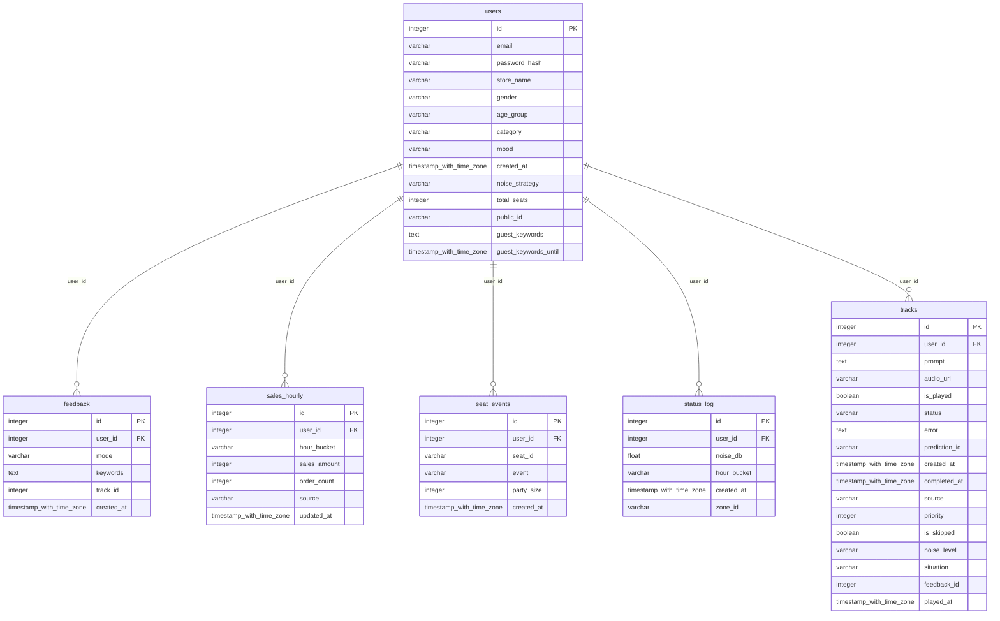

# NoiseAI ERD

`scripts/export_docs.py` 로 생성됨.

| 테이블 | 설명 |
| --- | --- |
| `users` | 점주 계정 + 매장 설정 |
| `tracks` | AI 생성곡 = 재생 대기열 |
| `status_log` | 3초마다 소음 dB |
| `seat_events` | 키오스크 자리 선택/퇴석 |
| `feedback` | 손님 키워드 요청 |
| `sales_hourly` | 시간대별 매출 |
